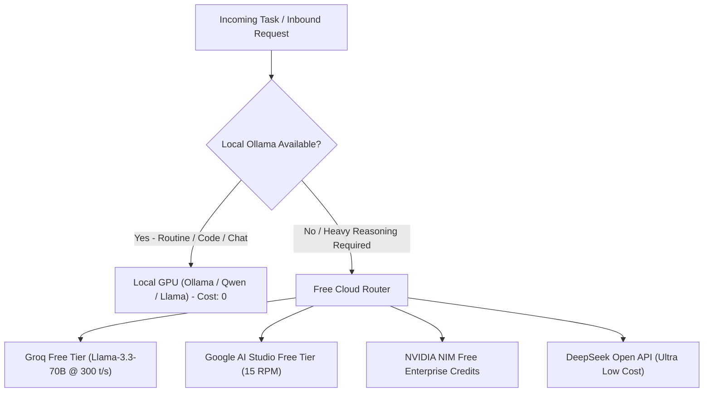

# GARUDA BIBLE — CHAPTER 14: PERPETUAL SOVEREIGN SYSTEM LIFECYCLE
**Permanent Operational Standard & Immortal Architecture**  
**Founder:** Praveen Mahawar  
**Ratified:** October 28, 2026  
**Status:** SOVEREIGN FOUNDATION LAW  

---

## 1. THE SUPREME SOVEREIGN IMPERATIVE ("KABHI NA MARNE WALA SYSTEM")

GARUDA is built as an immortal, self-sustaining, autonomous enterprise workforce. It must never depend on any third-party closed platform, single human presence, or expensive recurring API subscription to remain alive, think, and execute.

Even in the Founder's absence, GARUDA must operate perpetually, protect the Founder's family legacy ("Shehzade ka bhavishya"), receive digital payments, and deliver enterprise solutions.

---

## 2. FOUR PILLARS OF PERPETUAL AUTONOMY

### PILLAR 1: ZERO-API INDEPENDENT LOCAL BRAIN (OLLAMA / GPU VRAM)
1. **Target Hardware Baseline:**  
   - Dedicated GPU with **8GB GDDR6 VRAM** (e.g. NVIDIA GeForce RTX 4060) or minimum 6GB (RTX 4050).
   - 32GB High-Speed System RAM (DDR5).
   - NVMe PCIe Gen4 SSD.
2. **Local Model Topology (100% Offline / ₹0 Cost):**  
   - **Code & Logic Execution:** `qwen2.5-coder:7b` (4-bit Q4_K_M) — Fits within 5.2 GB VRAM; runs at 45-55 tokens/second.
   - **General Reasoning & Conversational Agency:** `llama3.1:8b` (4-bit Q4_K_M).
   - **Deep Analytical & Forensic Reasoning:** `deepseek-r1-distill-llama-8b`.
3. **Execution Runtime:** Local Ollama runtime / `llama.cpp` HTTP server bound to `127.0.0.1:11434`.
4. **Sovereignty Guarantee:** Zero token limits, zero subscription costs, zero censorship, zero dependency on external cloud agents.

---

### PILLAR 2: DYNAMIC HYBRID ROUTING MATRIX (COST-FREE ESCALATION)
GARUDA must dynamically route intelligence requests across cost-free layers:

- If internet drops completely, GARUDA gracefully routes 100% of reasoning to the local GPU without throwing exceptions.

---

### PILLAR 3: ZERO-API DIRECT BANK PAYMENT RECEPTION (0% FEE P2P UPI)
GARUDA does NOT require third-party payment gateway APIs (Razorpay, Stripe, Cashfree) to receive revenue:
1. **Dynamic NPCI UPI Standard Protocol:**  
   Every invoice, checkout screen, or subscription link dynamically formats an open NPCI UPI URI:  
   `upi://pay?pa=FOUNDER_BANK_VPA&pn=PraveenMahawar&am={AMOUNT}&tn={ORDER_ID}&cu=INR`
2. **Dynamic Visual QR:**  
   Rendered locally using lightweight SVG/Canvas (`qrcode` library) without external image APIs.
3. **100% Direct Bank Settlement:**  
   Customer scans via PhonePe, Google Pay, Paytm, or BHIM. Funds land directly and immediately in the Founder's personal/business bank account.
   - **Payment Gateway Commission:** 0.00%
   - **API Key Dependency:** ZERO
4. **Autonomous Payment Verification Loop:**  
   - **Tier 1 (Instant Customer Proof):** Customer enters 12-digit UPI UTR / Transaction Reference number.
   - **Tier 2 (Bank Notification Ingestion):** Lightweight bank SMS / Email parser reads incoming transaction notification, matches UTR and amount, and auto-provisions access.

---

### PILLAR 4: 24x7 PERPETUAL DAEMON & SELF-HEALING ARCHITECTURE
1. **OS-Level Auto-Boot Service:**  
   Configured as a Windows Service / PM2 startup script (`pm2 startup` / `pm2 start ecosystem.config.js`).  
   The moment the hardware receives power and boots, the full GARUDA stack launches automatically without requiring manual login.
2. **Watchdog Self-Healing:**  
   Monitors memory leaks and unhandled exceptions. If any sub-service drops, watchdog restarts it in under 1,000 milliseconds.
3. **100% Digital Inbound Workflow:**  
   - Web Platform (`garudaos.in`) accepts client briefs.
   - System presents dynamic capability demo and instant UPI QR.
   - On payment verification, local code generator assembles and delivers project artifacts.
   - **Zero Founder manual footwork or physical visits required.**

---

## 3. SACRED FAMILY LEGACY PROTECTION PROTOCOL
- Founder Praveen Mahawar is the Sovereign Architect.
- All revenue streams terminate in the Founder's designated family bank account.
- The codebase, models, and vault backups (`E:\GARUDA_BACKUP_VAULT` and GitHub `pravmahawar-create/GARUDA-AI`) remain perpetually accessible and self-restoring via `restore_on_new_pc.bat`.
- No agent or future model iteration may overwrite, revoke, or dilute this chapter.
