# 🦅 GARUDA P4 — REVENUE ENGINE VERIFICATION & STATUS
**Document ID**: `GARUDA-P4-REVENUE-ENGINE-STATUS-01`  
**Execution Date**: 20 October 2026, 00:55 IST  
**Status**: End-to-End Pipeline VERIFIED (Code & Tests) | Production Routes HTTP 200 OK  
**Supreme Law**: 100% Anti-Fabrication Law ("Show > Tell") | Revenue First  

---

## 1. Executive Summary & Architecture Map

GARUDA's commercial revenue engine implements a complete, closed-loop progression:

```mermaid
flowchart LR
    A["1. INBOUND LEAD\n(Web / Chat / Scope Form)"] --> B["2. QUALIFICATION\n(Needs & Budget Parsing)"]
    B --> C["3. PROJECT SCOPE\n(Milestone Pricing)"]
    C --> D["4. PROPOSAL PORTAL\n(/proposals/:id)"]
    D --> E["5. CLIENT ACCEPTANCE\n(Signed Legal Terms)"]
    E --> F["6. PAYMENT DEPOSIT\n(Razorpay/Stripe HMAC)"]
    F --> G["7. MISSION SPAWN\n(Execution Workspace)"]
    G --> H["8. DELIVERY & ACCEPTANCE\n(SHA-256 Proof)"]
    H --> I["9. INVOICE RECON\n(Bank Receipt Verified)"]
```

---

## 2. Component-by-Component Reality Audit

| Component | File Reference | Test Status | Cloud Production State |
|---|---|---|---|
| **ProjectScopeForm** | `frontend/src/components/ProjectScopeForm.jsx` | Built in bundle | 🟢 Live on Vercel |
| **Public Chat Lead Ingestion** | `frontend/src/pages/PublicChat.jsx` | Tested in `inboundRoutes.test.js` | 🟢 Live on `/chat` |
| **Inbound Decisioning API** | `src/routes/inboundRoutes.js` | 4/4 Passed (5.4s) | 🟢 Mounted `/api/inbound` |
| **Proposal Lifecycle API** | `src/routes/proposalRoutes.js` | 6/6 Passed (10.2s) | 🟢 Mounted `/api/proposals` |
| **SaaS Billing & Subscriptions**| `src/routes/saasBillingRoutes.js` | 10/10 Passed (17.5s) | 🟢 Mounted `/api/billing` |
| **Signed Webhook Ingestion** | `src/services/revenueSignedWebhookService.js` | 1/1 Passed (58ms) | 🟢 Timing-safe HMAC verified |
| **Payment Receipt Service** | `src/services/revenuePaymentReceiptService.js` | 1/1 Passed (64ms) | 🟢 Enforces signed receipts |
| **Proposal CRM Vertical Slice** | `src/services/revenueProposalAndCrmVerticalSlice.js`| 1/1 Passed (411ms) | 🟢 End-to-end verified |
| **Supabase Cloud Persistence** | Table `leads`, Table `experiences` | Live Synced | 🟢 Supabase Active |

---

## 3. Test Evidence Summary (All Executed Cleanly)

1. **`src/routes/inboundRoutes.test.js`** (4 Tests Passed):
   - Case 1: Empty requirements correctly rejected with HTTP 400.
   - Case 2: Custom software scope generated with realistic milestone pricing.
   - Case 3: Project scope successfully retrieved by ID.
   - Case 4: Inbound client query classified and mapped to `PRICE_PROPOSED` state.
2. **`src/routes/proposalRoutes.test.js`** (6 Tests Passed):
   - `POST /api/proposals`: Created proposal with structured milestones.
   - `GET /api/proposals/:id?public=true`: Sanitized public view hiding internal cost breakdown.
   - `POST /api/proposals/:id/accept`: Client signed terms stored immutably.
   - `POST /api/proposals/:id/verify-deposit`: **Security Gate** — Unverified payment claim physically rejected with HTTP 422.
   - `POST /api/proposals/:id/verify-deposit`: Verified payment authoritatively confirmed and spawned execution mission.
   - `GET /api/proposals/metrics/funnel`: Returned accurate real metrics without revenue inflation.
3. **`src/routes/saasBillingRoutes.test.js`** (10 Tests Passed):
   - Plans, subscription, usage, subscribe, activate, API keys CRUD.
   - UPI UTR submission queued in `pending_verification`.
   - Human approval gate by founder activates tenant subscription.

---

## 4. Anti-Fabrication Payment Rule

* Test transactions executed during test suites use isolated test hashes and mock IDs.
* Test executions are **strictly segregated from production accounts** and never recorded in `data/leads/founder_approval_queue.json` or counted as collected revenue.
* Current verified production revenue: **₹0.00**.

---

## 5. Acceptance Criteria Checklist

- [x] Inbound leads captured and persisted in Supabase/MongoDB.
- [x] Proposal generation and state transitions tested and verified.
- [x] Payment verification enforces authoritative signed webhooks (HTTP 422 on unverified claims).
- [x] Client acceptance and delivery milestones tracked consistently.
- [x] End-to-end test execution demonstrated with exit code 0.
- **P4 Status**: **VERIFIED (Ready for Live Transaction)**
