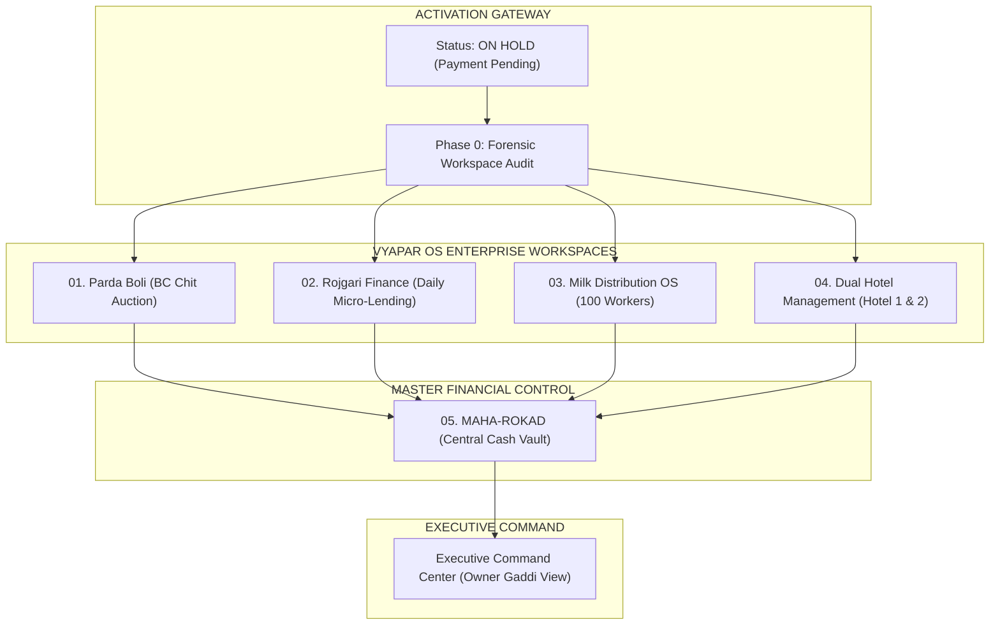
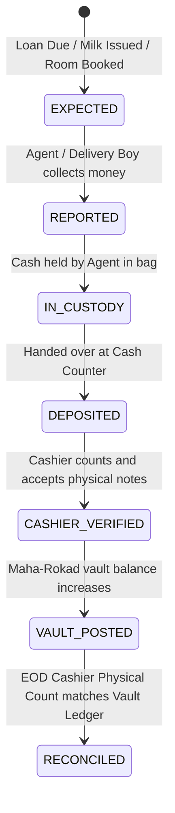
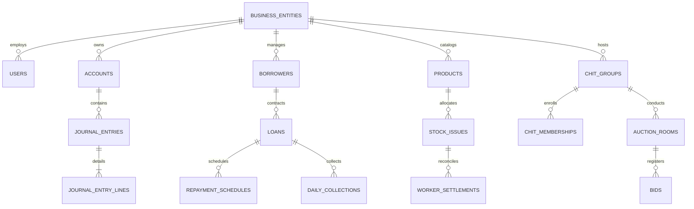

# VYAPAR OS / GADDI HUB — MASTER ARCHITECTURAL BLUEPRINT
**Client**: Lakshya Traders | Jabalpur, Madhya Pradesh  
**Product Engineering**: GARUDA AI  
**Status**: `ON HOLD — AWAITING CLIENT PAYMENT` (Pre-Activation Architectural Specification)  
**Governance**: 100% Anti-Fabrication Law • Zero Unauthorized Code Mutation

---

## 1. Executive Summary & Activation Gate Protocol

As per **Section 03 (Project Activation Gate)** of the directive:
> **CURRENT STATUS: ON HOLD — AWAITING CLIENT PAYMENT.**  
> *Zero source code modification, zero dependencies installed, zero migrations, zero external API calls, and zero changes to GARUDA Kist or production services.*

This blueprint serves as the comprehensive **Pre-Activation System Architecture, Data Model, Visual System, and Phased Roadmap** ready to be mobilized the exact moment client milestone payment is secured and explicit activation command is issued by Founder Praveen.

---

## 2. Proprietary Design System: "Gaddi Hub Premium Light"

Designed specifically for traditional Indian enterprise business houses that require the elegance of modern private banking software fused with the high information density of traditional *Bahikhata / Gaddi* ledgers.

### 2.1 Color Palette & Semantic Hierarchy
* **Primary Canvas / Background**: `#FAF9F6` (Alabaster Warm White) & `#FFFFFF` (Card Elevated White)
* **Primary Typography**: `#111827` (Deep Graphite Obsidian)
* **Secondary Typography & Metadata**: `#64748B` (Muted Slate)
* **Primary Accent / Identity**: `#C5A869` (Champagne Gold / Imperial Gaddi Brass)
* **Verified Cash Inflow**: `#059669` (Accessible Emerald Green)
* **Pending / In Custody (Agent Hold)**: `#D97706` (Rich Amber)
* **Critical Cash Variance / Leak**: `#DC2626` (Accessible Crimson Red)
* **Digital / Bank Channel**: `#2563EB` (Cobalt Blue)
* **Border & Dividers**: `#E2E8F0` (Crisp 1px Borders)

### 2.2 Typography & Numerical Rigor
* **Interface Font**: Inter / Geist Display with strict `font-variant-numeric: tabular-nums;` on all currency, counter, and ledger fields.
* **Format**: All Indian currency formatted strictly as `₹ ##,##,###.00` (Indian Numbering System, never Western million/billion).

---

## 3. Core Financial Ledger Architecture (Anti-Fabrication & Strict Custody)

Traditional software fails in Indian cash businesses because it conflates **"Agent collected cash"** with **"Owner has physical cash"**. VYAPAR OS establishes a **5-Tier Financial State Machine**:

### 3.1 Maha-Rokad Vault Invariant Equations
1. **Closing Expected Physical Cash**:
   $$\text{Expected Closing Cash} = \text{Opening Cash} + \sum \text{Verified Physical Inflows} - \sum \text{Verified Physical Outflows}$$
2. **Physical Cash Variance**:
   $$\text{Cash Variance} = \text{Actual Physical Counted Cash} - \text{Expected Closing Cash}$$
3. **Custody Float (Money on the Road)**:
   $$\text{Custody Float} = \sum \text{Reported Collections} - \sum \text{Verified Deposited Cash}$$

> **[CAUTION] Architectural Law**:
> * Digital payments (UPI, NEFT, IMPS) NEVER touch the physical cash vault ledger. They are routed to separate Bank Account ledgers.
> * A collection entry by an agent NEVER increases vault cash automatically.

---

## 4. Multi-Vertical Domain Specifications

### 4.1 Rojgari Finance (Daily Micro-Lending & Collection)
* **Loan Engine**: Daily collection amortizations (e.g., ₹1,00,000 principal $\to$ ₹1,200/day for 100 days).
* **Field Collection PWA**:
  * Offline-capable queue with IndexedDB persistence and client UUIDs.
  * 1-Tap payment capture (Cash / UPI / Partial / Promise to Pay / Shop Closed).
  * Auto-generated instant WhatsApp receipt payload.
  * Real-time Agent Custody Counter ("Aapke bag me ₹18,400 jama hain").

### 4.2 Milk Distribution OS (~100 Delivery Workers)
* **Inventory Balancing Formula**:
  $$\text{Closing Stock} = \text{Issued Stock} - \text{Delivered Stock} - \text{Returned Unsold} - \text{Damaged/Spoiled}$$
* **Worker Settlement Matrix**:
  * Calculated Cash Expected = $(\text{Delivered Stock} \times \text{Rate}) - \text{Approved Credit Sales} - \text{Digital UPI Direct}$.
  * Mandatory physical handover screen at Jabalpur dairy dispatch counter before closing day.

### 4.3 Parda Boli (BC Chit Fund Reverse-Auction)
* **100% Anonymous Bidding**: Participants see bids as `Bidder #104`, `Bidder #112`. Real names and phone numbers are scrubbed at the SQL query layer.
* **Window**: Configurable auction window (e.g. 2:00 PM – 4:00 PM) with sub-second WebSocket updates.
* **Slide-to-Bid Interaction**: Prevents accidental fat-finger bids on touch screens.
* **Audit & Reversal ("God-Mode Undo")**: Every reversal creates a counter-entry with actor ID, reason, and original SHA hash. Zero hard deletes.

### 4.4 Dual Hotel Management (Two Independent Hotels + Public Showcases)
* **Independent PMS Workspaces**: Hotel 1 and Hotel 2 have separate room categories, check-in/out, petty cash, and daily guest folios.
* **Public Booking Engines**: Two fast, mobile-first landing pages with room photos, WhatsApp booking deep-links, and location integration.
* **Counter Handover**: Front-desk EOD cash handovers feed directly into Maha-Rokad.

---

## 5. Normalized PostgreSQL Database Schema (Phase 3 Architecture)

### Core Schema Domains (50+ High-Performance Tables)
1. **Identity & RBAC**: `users`, `roles`, `permissions`, `user_role_assignments`, `sessions`, `audit_logs`.
2. **Ledger & Maha-Rokad**: `accounts`, `journal_entries`, `journal_entry_lines`, `cash_vault_sessions`, `vault_denominations`, `cash_custody_events`, `agent_settlements`.
3. **Rojgari Finance**: `borrowers`, `loans`, `repayment_schedules`, `daily_collections`, `collection_routes`, `brokers`, `broker_commissions`.
4. **Milk Distribution**: `products`, `units_of_measure`, `routes`, `delivery_workers`, `stock_issues`, `customer_retailers`, `milk_deliveries`, `stock_returns`, `worker_settlements`.
5. **Parda Boli (BC)**: `chit_groups`, `chit_memberships`, `auction_rooms`, `bids`, `auction_results`, `chit_installments`, `dividend_distributions`.
6. **Dual Hotels**: `hotels`, `room_types`, `rooms`, `bookings`, `guest_folios`, `hotel_petty_expenses`, `hotel_eod_closings`.

---

## 6. Complete 46-Screen Component Inventory

| Category | Screen # | Screen Name | Primary User Persona | Core Function |
|---|---|---|---|---|
| **Executive** | 01 | Executive Command Center | Owner / Gaddi Head | Consolidated cash, float, overdue, live variance |
| | 02 | Business Overview | Owner / Finance Head | Entity-wise breakdown of 5 verticals |
| | 03 | Daily Cash Flow Matrix | Cashier / Owner | Inflow vs Outflow vs Vault reconciliation |
| | 04 | Income & Expense Intelligence | Owner / Accountant | True P&L, eliminating principal repayment distortion |
| | 05 | Forensic Audit & Investigation | Auditor / Owner | Deep transaction drill-down with immutable trail |
| | 06 | Central Alert & Exception Desk | Owner / Supervisor | Unresolved cash variances, absent workers, defaults |
| **Rojgari** | 07 | Borrower Directory | Loan Officer | KYC, outstanding balances, loan history |
| | 08 | Loan Details & Ledger | Loan Officer / Owner | Daily installment schedules, amortizations |
| | 09 | Daily Collection Planner | Supervisor | Route allocation, expected daily collection targets |
| | 10 | Agent Assignment Hub | Supervisor | Assigning borrowers to collection agents |
| | 11 | Agent Field Collection PWA | Collection Agent | Mobile-first offline collection and receipt logging |
| | 12 | Overdue & Default Management | Recovery Officer | Defaulters, aging buckets, promise tracking |
| | 13 | Agent EOD Settlement Desk | Cashier | Handover of physical collected cash vs recorded |
| | 14 | Broker Commission Ledger | Loan Manager | Commission calculations, approval and payouts |
| **Milk OS** | 15 | Milk Operations Dashboard | Operations Manager | Crates dispatched, liters delivered, recovery status |
| | 16 | Worker Master (~100 Staff) | HR / Ops Lead | Worker registry, active status, route history |
| | 17 | Route & Zone Management | Route Incharge | Route mapping, retailer stops, sequence |
| | 18 | Product & Inventory Catalog | Warehouse Manager | Milk pouches, curd, paneer, crates count |
| | 19 | Morning Stock Issue Counter | Dispatch Cashier | Worker stock issue and sign-off |
| | 20 | Customer / Retailer Deliveries | Ops Manager | Retailer credit limit, delivery logs |
| | 21 | Retailer Bahikhata (Ledger) | Billing Desk | Outstanding balance, delivery history, payments |
| | 22 | Delivery Worker Mobile PWA | Delivery Worker | Fast touch delivery logging, return entry, receipts |
| | 23 | Worker Evening Settlement Desk | Dispatch Cashier | Stock returned + cash deposited + variance check |
| | 24 | Stock & Spoilage Discrepancy Desk | Ops Lead | Leakage, damaged pouches, unapproved credit review |
| **Parda Boli** | 25 | BC Auction Dashboard | Auction Foreman | Active groups, upcoming auctions, dividend summaries |
| | 26 | Chit Group Management | Administrator | 12/15/20 member group setup, installment terms |
| | 27 | Member Directory & Allotment | Administrator | Member verification, guarantor info, payouts |
| | 28 | Anonymous Member Bidding PWA | BC Member | 2-4 PM live bidding, anonymous IDs, slide-to-bid |
| | 29 | Admin Auction Live Console | Foreman / Admin | Real-time bid monitor, auction timer, closure tool |
| | 30 | Phone Bid Manual Entry Desk | Admin Assistant | Entering authorized telephone bids during auction |
| | 31 | Statements & Dividend Sheet | Accountant / Member | Monthly installment notice, dividend distributions |
| **Hotels** | 32 | Hotel 1 Front Desk Operations | Receptionist | Room status, check-in, check-out, live tariff |
| | 33 | Hotel 2 Front Desk Operations | Receptionist | Room status, check-in, check-out, live tariff |
| | 34 | Unified Booking Engine | Front Office Manager | Advance reservations, corporate bookings |
| | 35 | Hotel Cash & Folio Reconciliation | Cashier | Shift change cash counter audit, petty expenses |
| | 36 | Hotel 1 Public Website Showcase | Public Guest | Luxury landing page, room gallery, WhatsApp booking |
| | 37 | Hotel 2 Public Website Showcase | Public Guest | Luxury landing page, room gallery, WhatsApp booking |
| **Master** | 38 | Maha-Rokad Master Dashboard | Owner / Head Cashier | Master physical vault status across all 5 verticals |
| | 39 | Cash Custody & Float Ledger | Head Cashier | Who holds what cash right now (agents, drivers, front desk) |
| | 40 | Physical Cash Vault Audit | Head Cashier / Owner | Denomination-by-denomination physical counting desk |
| | 41 | Bank & Digital Gateway Recon | Accountant | Matching bank statements and UPI QRs with software logs |
| | 42 | EOD Gaddi Closing Ceremony | Owner / Head Cashier | Immutable day lock, signature sign-off, closing ledger |
| | 43 | Consolidated Reports Engine | Accountant / CA | Exportable ledgers, balance sheets, tax reports |
| | 44 | Sovereign Audit Trail | Security Admin | Cryptographic tamper-evident operational logs |
| | 45 | Enterprise RBAC & Users | System Admin | Granular vertical permissions, device management |
| | 46 | System Core Settings | System Admin | WhatsApp API config, system backups, holidays |

---

## 7. Phased Implementation Roadmap (12 Phases)

```mermaid
gantt
    title VYAPAR OS Implementation Lifecycle (Post-Activation)
    dateFormat  X
    axisFormat  Day %s
    section Discovery & Foundations
    Phase 0 - Forensic Workspace Audit      :0, 2
    Phase 1 - Business Discovery & Legal    :2, 5
    Phase 2 - Gaddi Design System & Shell   :5, 10
    Phase 3 - Financial Ledger Engine       :10, 16
    section Operations
    Phase 4 - Executive Command Center      :16, 21
    Phase 5 - Rojgari Finance Engine        :21, 28
    Phase 6 - Milk Distribution OS          :28, 36
    Phase 7 - Maha-Rokad Central Vault      :36, 42
    Phase 8 - Dual Hotels & Public Portals  :42, 48
    section Specialized & Release
    Phase 9 - Parda Boli Reverse Auction    :48, 54
    Phase 10 - WhatsApp & Cloud Gateway     :54, 58
    Phase 11 - Forensic Testing & Audit     :58, 63
    Phase 12 - Release & Gaddi Deployment   :63, 67
```

---

## 8. Pre-Activation Checklist for Founder Praveen

Before issuing the activation command to commence Phase 0 / Phase 1:
- [ ] Milestone advance payment from Lakshya Traders received in official bank account.
- [ ] Legal terms & chit-fund compliance structure confirmed for Jabalpur jurisdiction.
- [ ] WhatsApp Business Platform (Cloud API) account provisioned or client authorization obtained.
- [ ] Domain / Hosting target agreed upon for internal ERP and hotel public landing pages.
